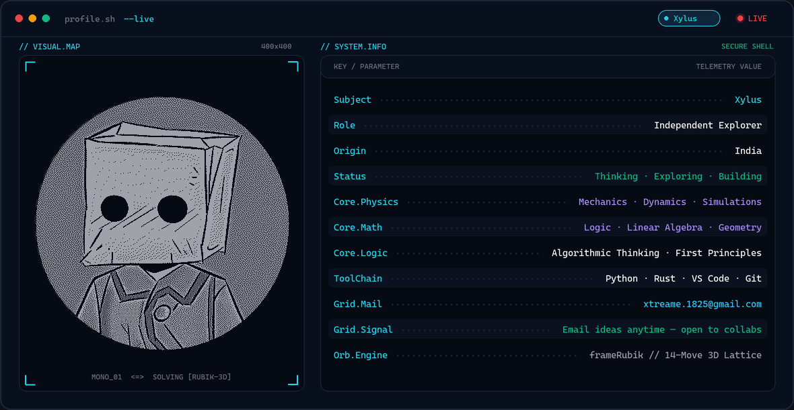

  <picture>
    <source media="(prefers-color-scheme: dark)" srcset="./assets/banner-dark.gif" />
    <source media="(prefers-color-scheme: light)" srcset="./assets/banner-light.gif" />
    
  </picture>

 

<!-- =======================================================================
     PHASE 2: STATS CARDS
     Streak card works immediately for @xtreame-x.
     Self-hosted Stats & Top-Langs are commented out below so there are no
     broken placeholder images before you deploy Vercel (see SETUP_GUIDE.md).
     Once deployed, uncomment and replace YOUR_VERCEL_URL.
     (hide_rank=true is kept because rank weights public stars heavily.)
     ======================================================================= -->

  

<!--

  
  

-->

 

<!-- =======================================================================
     PHASE 3: CONTRIBUTION SNAKE
     Works automatically right after "Generate Contribution Snake" runs
     green for the first time and creates the `output` branch.
     ======================================================================= -->

  <picture>
    <source media="(prefers-color-scheme: dark)" srcset="https://raw.githubusercontent.com/xtreame-x/xtreame-x/output/github-snake-dark.svg" />
    <source media="(prefers-color-scheme: light)" srcset="https://raw.githubusercontent.com/xtreame-x/xtreame-x/output/github-snake.svg" />
    
  </picture>

 

<!-- =======================================================================
     PHASE 4: SOCIAL & CONTACT BADGES
     If adding LinkedIn later, keep logoColor=0A66C2 (custom colours hide
     the LinkedIn glyph on shields.io) or embed a base64 data-URI glyph.
     ======================================================================= -->

  &nbsp;&nbsp;

